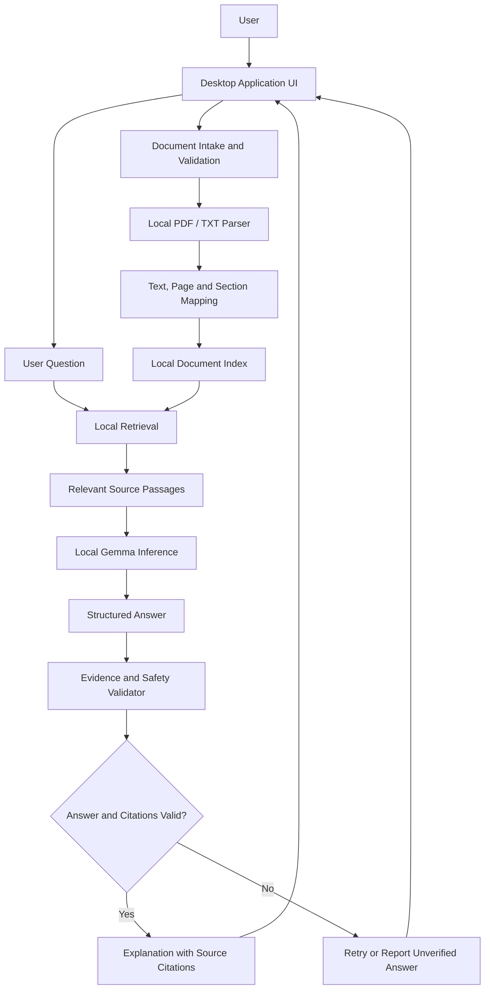
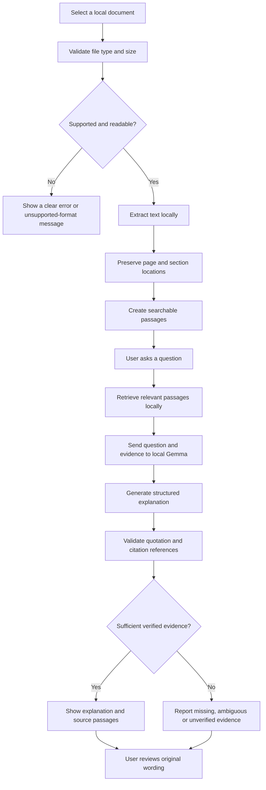
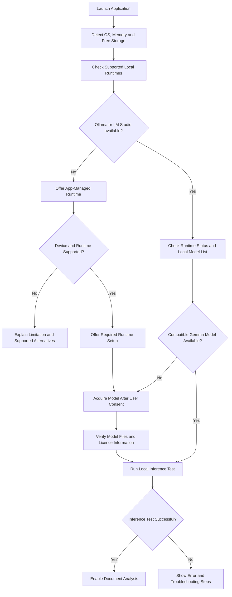

# Build.exe
# PLATO: Private Legal Agent for Triage & Operations
PS2 — Agentic AI: Private Legal Document Triage Agent
**An offline-first AI assistant that helps people understand legal documents while keeping their private information on their own device.**

> **Project status:** 🚧 Active development  
> **Competition:** ZeroDay OSS Hacktoberfest 2026 — PS2  
> **Initial domain:** Indian residential rental agreements  
> **AI model family:** Google Gemma  
> **License:** MIT for our original project code; third-party models and datasets retain their own licences.

---

## Table of Contents

- [Overview](#overview)
- [The Problem](#the-problem)
- [Our Solution](#our-solution)
- [Core Features](#core-features)
- [Project Scope](#project-scope)
- [System Architecture](#system-architecture)
- [Document Analysis Flow](#document-analysis-flow)
- [Local AI Setup Flow](#local-ai-setup-flow)
- [Technology Stack](#technology-stack)
- [Privacy and Network Isolation](#privacy-and-network-isolation)
- [Security Design](#security-design)
- [AI and Data Strategy](#ai-and-data-strategy)
- [Testing and Evaluation](#testing-and-evaluation)
- [Installation and Usage](#installation-and-usage)
- [Repository Structure](#repository-structure)
- [Roadmap](#roadmap)
- [Contributing](#contributing)
- [Limitations and Disclaimer](#limitations-and-disclaimer)
- [License](#license)

---

## Overview

Legal documents often contain complicated language, long clauses, unfamiliar terminology, deadlines, financial obligations, and conditions that are difficult for a non-lawyer to interpret.

The **Private Legal Document Triage Agent** is an open-source project designed to make these documents easier to understand.

Users will be able to import a supported document, receive a plain-language explanation, identify important clauses, and ask questions about what the document actually states.

Unlike a typical cloud-based AI chatbot, our intended design uses local document processing and local Gemma inference. Private document contents must not be transmitted to external AI services during normal analysis.

The application will also provide evidence for its answers by linking explanations to identifiable passages in the original document.

Our guiding principle is:

**Explain what the document says, show the evidence, acknowledge uncertainty, and never pretend to replace a qualified legal professional.**

## The Problem

Understanding a legal document can be difficult because:

- Legal language may be unfamiliar to ordinary users.
- Important obligations and deadlines can be buried in lengthy agreements.
- Users may struggle to locate clauses about rent, deposits, maintenance, penalties, or termination.
- AI-generated explanations can sound convincing even when they are unsupported by the source.
- Uploading private legal documents to online AI services can create privacy concerns.
- A document may be ambiguous, incomplete, contradictory, or silent about the user's question.

Our project aims to address these problems through a combination of local AI, document retrieval, verifiable citations, and explicit uncertainty handling.

## Our Solution

The application is being designed around five principles:

1. **Local-first processing:** private documents and their derived content remain on the user's device during analysis.
2. **Evidence-grounded answers:** explanations must be supported by identifiable source passages.
3. **Honest uncertainty:** missing information and ambiguous wording must be reported rather than guessed.
4. **Safe legal-document triage:** the application explains and organises information without issuing definitive legal judgments.
5. **Reproducible open-source software:** developers and evaluators should be able to inspect the architecture, install the required components, and reproduce the demonstration.

---

## Core Features

The following features describe the intended product. They are not claims that every feature has already been implemented.

| Feature | Description | Status |
|---|---|---|
| PDF and TXT ingestion | Import supported legal documents from the user's device | Planned |
| Local text extraction | Extract text while preserving page references | Planned |
| Plain-language summaries | Explain important clauses in understandable language | Planned |
| Key-term extraction | Identify rent, deposits, dates, obligations, notice periods, penalties, and termination clauses where present | Planned |
| Document Q&A | Ask questions about the uploaded agreement | Planned |
| Evidence citations | Display exact source passages with page or section references | Planned |
| Uncertainty handling | Identify missing, ambiguous, or conflicting information | Planned |
| Local Gemma inference | Use a compatible Gemma model through a tested local runtime | Planned |
| AI setup wizard | Detect supported local runtimes and guide model installation | Planned |
| Offline verification | Demonstrate document analysis with networking disabled | Planned |
| Security testing | Test prompt injection, unsafe files, logging, and data handling | Planned |
| Additional document domains | Extend the pipeline to other categories after the initial domain is validated | Future |

---

## Project Scope

### Initial domain: Indian residential rental agreements

The first version will focus on rental agreements rather than attempting to cover every area of law immediately.

The application will aim to identify and explain, where specified in the source:

- Parties to the agreement
- Monthly rent and payment terms
- Security deposit and refund conditions
- Agreement duration and expiry date
- Notice periods
- Maintenance and repair responsibilities
- Utility and other payment obligations
- Rent revision conditions
- Termination clauses
- Penalties and other significant obligations
- Missing, ambiguous, or potentially conflicting terms

These are document-analysis tasks. Finding a clause does not establish that it is legally valid, enforceable, or applicable in a particular jurisdiction.

### Future domains

The architecture should make it possible to add other categories without rewriting the complete application.

Potential future domains include employment contracts, service agreements, legal notices, consumer disputes, and other legal documents.

Each added domain will need its own examples, evaluation cases, and clearly stated limitations.

---

## System Architecture

The application will separate the user interface, document processing, retrieval, AI inference, and evidence validation.

This separation makes the project easier to test and allows the local model runtime to change without rewriting the document-analysis pipeline.



### Component responsibilities

**1. User interface**

The interface will allow users to select a document, view its analysis, ask questions, and inspect the original passages supporting an answer.

**2. Document intake and validation**

Files will be checked before processing. The application should reject unsupported or malformed files and enforce limits on file size, page count, and processing resources.

**3. Local document parser**

The parser will extract text from supported formats and retain page numbers or other source locations. If a scanned PDF cannot be read by the selected parser, the application should report that limitation rather than pretending the document was analysed.

**4. Local document index**

Extracted passages will be organised into searchable sections or chunks. Source identifiers and page references must be retained.

**5. Local retrieval**

The retrieval component will locate passages relevant to the user's question. The initial implementation may use lexical search, with local embeddings considered later if they improve measured retrieval quality.

**6. Local Gemma inference**

Gemma will interpret relevant passages and produce structured explanations. It will not be given unrestricted access to the filesystem, shell, or network.

**7. Evidence and safety validator**

The application will check whether citations refer to real passages and whether quoted text matches the source. Unsupported claims should be withheld or reported as unverified.

**8. Results interface**

The user will see the explanation, supporting source text, relevant caveats, and a clear indication when the document does not answer a question.

---

## Document Analysis Flow

This flow represents the intended processing sequence for a user analysing a document.



### Evidence-grounding rules

The model must not be trusted to invent its own source references.

The application will aim to:

- Preserve identifiers for extracted passages.
- Check that each cited passage exists.
- Verify that quoted text matches the extracted source text.
- Check the page or section reference associated with the passage.
- Distinguish source wording from the model's interpretation.
- Report when evidence is insufficient.
- Avoid presenting unsupported legal conclusions as facts.

For example, if an agreement does not specify a notice period, the application should report that no relevant notice-period clause was found. It should not invent a typical period or conclude that the absence of a clause establishes a legal right.

---

## Local AI Setup Flow

A key usability goal is to support people who have neither Ollama nor LM Studio installed.

The intended first-run wizard will check the device, detect supported local runtimes, look for compatible local Gemma models, and guide the user through any required setup.



### Runtime compatibility

The implementation must not assume that a particular model can run in every runtime.

The setup process will verify:

- Whether the runtime is installed and responding
- Whether the expected model is available
- Whether the model format and quantization are supported
- Whether the device has sufficient resources
- Whether the model can complete a local inference test

If neither supported runtime is available, the intended fallback is an application-managed runtime. The application should ask before installing components or downloading large model files.

**Desktop comes first.** Mobile support will require a separately verified on-device runtime and appropriately sized model; desktop setup should not be presented as compatible with every mobile phone.

### Model choice and acquisition

Google Gemma is the required model family for this project.

The exact checkpoint, model format, quantization, and inference runtime will be documented after compatibility testing and confirmation of competition requirements. Model weights will not be committed to the source repository.

Before release, the project will document the model source, licence, expected download size, resource requirements, and reproducible setup procedure.

---

## Technology Stack

The initial implementation is planned around a modular local application.

| Component | Proposed approach |
|---|---|
| Programming language | Python |
| Desktop UI | PySide6 or another verified desktop UI framework |
| Document processing | Local PDF and text parsing libraries |
| AI model family | Google Gemma |
| Inference | A tested local runtime through a provider adapter |
| Retrieval | Local lexical retrieval initially; local embeddings may be considered later |
| Evidence validation | Deterministic application code |
| Testing | Automated unit, integration, security, and evaluation tests |
| Version control | Git and GitHub |
| Continuous integration | GitHub Actions or an equivalent CI system |

These are proposed implementation choices. Exact dependencies and versions will be pinned and published once the first working implementation is established.

---

## Privacy and Network Isolation

Privacy is a core design requirement, not an optional setting.

During normal document processing, the intended system will keep the following on the user's device:

- Uploaded documents
- Extracted text
- Document chunks and search indexes
- Embeddings, if used
- Prompts containing private document information
- Model-generated summaries and answers
- Names, metadata, and document-related questions

### Setup versus normal operation

Internet access may be required during setup to obtain public model weights or software dependencies. Such setup must be separated from normal document processing.

The normal analysis workflow must not depend on a cloud AI API, hosted OCR service, cloud embedding service, or remote storage that receives private document content.

Any remaining network functionality must be documented, carry no private document content, and be optional or disabled by default.

### Offline verification plan

The project will include reproducible steps for:

1. Acquiring the required software and model during setup.
2. Closing the application and disabling networking at the operating-system or isolated-environment level.
3. Relaunching the application and analysing a test agreement.
4. Asking questions and opening source citations while offline.
5. Capturing connection-monitoring or network-blocking evidence.
6. Inspecting application logs, caches, and temporary files.
7. Repeating the test after a fresh launch.

The offline test will be accompanied by a review of source code and dependencies for outbound requests and telemetry.

A successful offline test alone does not prove that every possible data leak is impossible. The project will document its threat model, evidence, and limitations honestly.

---

## Security Design

Legal documents must be treated as untrusted input.

The project will use a security-focused development and review process covering:

| Threat | Intended mitigation |
|---|---|
| Prompt injection in uploaded text | Treat document content as data, not instructions to the model or application |
| Fabricated clauses or citations | Validate citations and quotations in application code |
| Malformed or unusually large files | Enforce processing limits and fail safely |
| Unsafe file paths | Restrict document handling to approved application-managed locations |
| Private content in logs | Avoid logging document text, prompts, answers, and personal metadata |
| Unauthorised network requests | Audit dependencies and verify network-disabled processing |
| Exposed local inference service | Bind local services to loopback where appropriate and restrict access |
| Untrusted model downloads | Verify download sources, file integrity, versions, and licence information |
| Secrets committed to GitHub | Use secret scanning and repository hygiene checks |
| Unintended retention | Minimise storage, clean temporary files, and document deletion behaviour |

The model will not be given unrestricted shell, filesystem, or network tools.

Security checks will be part of development and release testing rather than relying solely on a final manual review.

---

## AI and Data Strategy

### No training from scratch

The initial version will use a pretrained Gemma model. The project does not plan to train a new foundation model from scratch.

The primary approach will combine:

1. **Prompting:** Clear instructions and structured output requirements.
2. **Local retrieval:** Finding relevant passages from the uploaded document.
3. **Grounding:** Giving the model relevant source text to explain.
4. **Deterministic validation:** Checking citations and quoted wording after generation.
5. **Evaluation:** Comparing outputs against manually reviewed expected answers.

Fine-tuning will only be considered if evaluation identifies a specific weakness that cannot reasonably be addressed through retrieval, prompting, or code-level validation.

### Initial evaluation data

The project will prioritise fictional rental agreements created specifically for testing.

Synthetic examples will include:

- Explicit rent and deposit clauses
- Different notice periods
- Missing clauses
- Conflicting clauses
- Ambiguous obligations
- Unusual wording
- Varied layouts and document lengths
- Adversarial text intended to test prompt-injection resistance

Each evaluation example will have expected results prepared or reviewed independently of the model's output.

Public datasets and official legal sources may be used as supplementary material only after their licences, attribution requirements, access terms, and redistribution permissions are checked.

Private user documents will not be added to the public repository.

### Legal reference material

If external legal references are introduced later, they will be stored and presented separately from evidence extracted from the user's agreement.

The project will not assume that a contract clause is legally valid simply because it appears in the document, or that a statute automatically resolves every question about the agreement.

---

## Testing and Evaluation

The application will be evaluated on documents and questions that were not hard-coded into the product.

Planned evaluation categories include:

- Correct extraction of key facts and obligations
- Accuracy and completeness of plain-language explanations
- Exact quotation and citation validity
- Appropriate handling of missing evidence
- Detection of vague or conflicting provisions
- Refusal of unsupported legal conclusions
- Robustness against malformed files and prompt injection
- Offline operation and network behaviour
- Resource use and responsiveness
- Reproducibility on a clean installation

The team will publish the test method, expected answers, measured results, and known limitations.

Zero fabricated citations is a target for the evaluation suite. Any failed citation test will need investigation and regression testing before release.

---

## Installation and Usage

The application is currently under development. Final installation commands will be added once the runtime, dependencies, and packaging process have been tested.

### Planned user workflow

1. Download and launch the desktop application.
2. Follow the first-run environment and model setup checks.
3. Obtain the supported Gemma model if it is not already available.
4. Run the local-inference readiness test.
5. Select a supported rental agreement in PDF or TXT format.
6. Review the document summary and key clauses.
7. Ask questions and inspect the original passages supporting the answers.

### Developer setup

Development instructions, pinned dependencies, supported operating systems, test commands, and troubleshooting guidance will be documented in this section before the first stable release.

The setup process must not require undisclosed credentials or a paid cloud AI service to reproduce the core demonstration.

---

## Repository Structure

The repository is planned to use a modular structure similar to the following:

```text
private-legal-triage/
├── app/
│   ├── ui/
│   ├── document_parser/
│   ├── retrieval/
│   ├── inference/
│   ├── evidence_validator/
│   ├── model_setup/
│   └── safety/
├── configs/
│   └── rental_agreements/
├── tests/
│   ├── unit/
│   ├── integration/
│   ├── evaluation/
│   ├── security/
│   └── offline/
├── test-data/
│   ├── synthetic/
│   └── expected-results/
├── docs/
│   ├── architecture.md
│   ├── threat-model.md
│   ├── privacy-design.md
│   ├── offline-testing.md
│   ├── evaluation-results.md
│   └── model-and-dataset-licences.md
├── scripts/
├── .github/
│   ├── ISSUE_TEMPLATE/
│   └── workflows/
├── README.md
├── LICENSE
├── CONTRIBUTING.md
├── SECURITY.md
├── CODE_OF_CONDUCT.md
└── .gitignore
```

The final structure may change as implementation decisions are made. Only add modules and files that have a clear purpose.

---

## Roadmap

### Phase 1 — Foundation

- [ ] Establish the repository structure and development conventions.
- [ ] Verify local Gemma inference with a supported runtime.
- [ ] Select the first model configuration.
- [ ] Document runtime, hardware, and licence requirements.

### Phase 2 — Document processing

- [ ] Implement PDF and TXT ingestion.
- [ ] Preserve page and section locations.
- [ ] Create synthetic rental agreements with expected answers.
- [ ] Implement local retrieval.

### Phase 3 — AI and evidence grounding

- [ ] Integrate Gemma with retrieved document passages.
- [ ] Generate structured summaries and explanations.
- [ ] Implement citation validation.
- [ ] Handle missing, ambiguous, and conflicting evidence.
- [ ] Add safe refusal and escalation behaviour.

### Phase 4 — User experience and setup

- [ ] Build the desktop interface.
- [ ] Detect supported local AI runtimes.
- [ ] Detect compatible locally available models.
- [ ] Implement user-approved model acquisition and a managed-runtime fallback.
- [ ] Test clean-install and insufficient-resource scenarios.

### Phase 5 — Privacy and security

- [ ] Audit outbound network calls and dependencies.
- [ ] Implement privacy-safe logging and temporary-file handling.
- [ ] Test prompt injection and malformed input.
- [ ] Run and document a network-disabled demonstration.
- [ ] Publish a threat model and evaluation results.

### Phase 6 — Release

- [ ] Finalise setup instructions and dependency versions.
- [ ] Verify code, model, and dataset licensing.
- [ ] Run the full automated test suite.
- [ ] Test the README instructions in a clean environment.
- [ ] Record a demonstration showing both successful and limited answers.
- [ ] Publish a versioned release with known limitations documented.

Additional legal domains, multilingual support, OCR, and agreement comparison will be considered after the initial domain is sufficiently reliable.

---

## Contributing

Contributions are welcome once the repository's development workflow is established.

Before submitting a pull request:

1. Read the contribution instructions.
2. Keep changes scoped and explain their purpose.
3. Add or update tests for new behaviour.
4. Avoid introducing remote services that receive private document content.
5. Never commit secrets, private legal documents, model weights, or datasets without verified redistribution permission.
6. Document any new dependencies, model requirements, or licence obligations.

All changes should be reviewed and tested before being merged.

Security issues should be reported through the process described in `SECURITY.md` rather than by publishing sensitive vulnerability details in a public issue.

---

## Limitations and Disclaimer

This project is an experimental legal-document understanding tool. It is intended to help users navigate and understand document wording, not to replace a lawyer or provide definitive legal advice.

The application cannot independently establish that an agreement is valid, enforceable, unlawful, or appropriate for a particular dispute. Legal outcomes may depend on jurisdiction, current law, facts outside the document, and professional interpretation.

Model-generated explanations may be incorrect or incomplete. Users should verify important findings against the original wording and seek qualified legal assistance when necessary.

The project will state its supported document types, tested environments, evaluation results, and known limitations transparently.

---

## License

The original project source code is intended to be released under the **MIT License**.

This licence does not automatically apply to Gemma model weights, third-party libraries, datasets, or external legal materials. Their individual licences and usage terms must be respected.

See the [`LICENSE`](LICENSE) file for the terms applicable to the project's original source code, and consult the documentation for model and dataset attribution.

---

**Built as an open-source project for ZeroDay OSS Hacktoberfest 2026 — PS2.**

Our objective is to make legal documents easier to understand without sacrificing evidence, privacy, or honesty about uncertainty.
